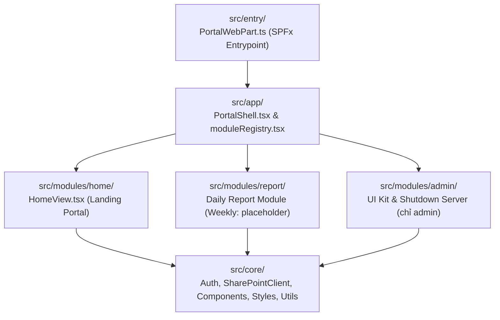

# Kiến Trúc Dự Án THADICO DQM - Workspace Portal (SPFx 1.24.1)

> **Mô hình kiến trúc:** Multi-Module Workspace Portal (Layered & Feature-Oriented React trên nền tảng SharePoint Framework `1.24.1`)
> **Mục tiêu:** Đảm bảo tính đóng gói độc lập giữa các module nghiệp vụ (hiện có `report`, `admin`, `home`), dùng chung tầng hạ tầng cốt lõi (`core/`), miễn phí 100% bản quyền (không phụ thuộc Power Apps Premium), và dễ dàng mở rộng thêm module mới.

---

## 1. Sơ đồ phân tầng kiến trúc (Layered Architecture)



### Quy tắc phụ thuộc một chiều (One-Way Dependency Rule)
- `entry/` $\rightarrow$ `app/` $\rightarrow$ `modules/*` $\rightarrow$ `core/*`
- **Tầng `core/` KHÔNG BAO GIỜ import từ `modules/*`.**
- **Các module trong `modules/*` KHÔNG import chéo lẫn nhau.**
- Tầng `core/` và `app/` giữ tên trung lập, chỉ các file bên trong `src/modules/<name>/` mới mang tiền tố của module đó.

---

## 2. Cấu trúc thư mục chi tiết

```text
DQM_workspace_portal/
├── config/                              # Cấu hình SPFx build, serve & package-solution
├── sharepoint/solution/                 # Gói cài đặt thành phẩm (workspace_portal.sppkg)
├── scripts/check-styles.js              # Kiểm tra quy ước style (npm run lint:styles)
├── dev/                                 # Khung chạy thử module Report không cần SharePoint + test (KHÔNG vào gói web part)
├── docs/
│   ├── REPORT_JSON_PLAN.md              # Hợp đồng JSON/HTML của báo cáo ngày và lý do thiết kế
│   ├── SHAREPOINT_SETUP.md              # Hướng dẫn cài đặt SharePoint thủ công
│   ├── sample/                          # Báo cáo mẫu (JSON + HTML độc lập)
│   └── sharepoint_setup/                # *_list.xlsx tạo list + script cài đặt tự động (setup-sharepoint.mjs)
├── data_test/
│   ├── Mau_BCN_ST06_20261025.pdf        # Mẫu giấy chuẩn Báo cáo ngày A4 song ngữ
│   └── sharepoint_sample/               # Bản mẫu thư viện CapNhatCongViec
│       ├── ActivityP6.xlsx              # Danh mục Activity (một sheet)
│       ├── _template/                   # template_DRP_<Unit>_<yyyyMMdd>.json
│       ├── resource/                    # thaco_logo.jpg, crec_logo.jpg
│       └── data/                        # Báo cáo mẫu data/<Unit>/<DocID>_<yyyyMMdd>/
├── src/
│   ├── entry/                           # Điểm vào SPFx WebPart (PortalWebPart.ts, manifest, loc/)
│   ├── app/                             # Khung điều phối Portal
│   │   ├── PortalShell.tsx              # SSO M365, nhận diện từ UserProfiles, chế độ bảo trì, chuyển module
│   │   ├── moduleRegistry.tsx           # Đăng ký các PortalModule
│   │   └── IPortalProps.ts
│   ├── core/                            # Hạ tầng dùng chung (KHÔNG import từ modules/)
│   │   ├── auth/                        # UserProfileService, checkIsAdmin, extractCleanEmail
│   │   ├── services/                    # SharePointClient (REST list/file/folder/ETag), RoleResolutionService, PortalConfigService
│   │   ├── components/                  # Icon, PageHeader, FilterChips, SearchInput, State, TileGrid, PromptDialog, CreatableSelect, layout/ToastAlert
│   │   ├── constants/ types/ utils/     # Hằng số, kiểu dùng chung, xử lý đường dẫn SharePoint
│   │   └── styles/                      # Design System: tokens.css, base.css, components/*.css, layout/landing.css, index.ts
│   └── modules/
│       ├── home/                        # HomeView: trang chủ liệt kê module từ registry
│       ├── admin/                       # Admin Config (chỉ admin): UI Kit (Style Guide), Shutdown Server
│       └── report/                      # Module Quản lý Báo cáo (library CapNhatCongViec)
│           ├── ReportModule.tsx
│           ├── views/                   # ReportLandingView, ReportCalendarView, ReportEntryView, ReportOverviewView
│           ├── components/              # Form động (ReportDynamic*, ReportFieldsGrid, ReportMetaForm, ReportSectionsEditor, ảnh), bản in A4 (ReportPrint*), ReportSignedDocument, ReportTaskTable (weekly placeholder)
│           ├── services/                # ReportDataService, ReportFileService, ReportTemplateService, ReportRegistryService, ReportCatalogService, ReportRoleService
│           ├── utils/                   # reportJson (JSON ↔ mô hình ↔ template), reportTable/Form/Sections, reportCatalog, reportHtml (HTML độc lập), reportCalendar/Overview/Export, reportFileNaming, reportImage…
│           ├── types/                   # report.types.ts, reportJson.types.ts
│           ├── constants/               # reportConfig, reportStorageKeys
│           └── report.css               # Style riêng của module (tiền tố report-)
├── AGENTS.md                            # Quy chuẩn bắt buộc dành cho AI Agent & Developer
├── project_architecture.md              # Tài liệu kiến trúc tổng thể dự án
└── README.md                            # Hướng dẫn cài đặt, chạy thử nghiệm và đóng gói
```

---

## 3. Điểm nhấn kiến trúc các Module chính

### 3.1 Tầng `core/` (Shared Infrastructure)
- **`SharePointClient.ts`:** Bao bọc `SPHttpClient.configurations.v1` với header `Accept: application/json;odata=nometadata`, hỗ trợ List Items (`getItems`, `queryItems`, `getListFieldMap` tra tên nội bộ cột theo tên hiển thị, `createItem`, `updateItem`) và Document Library (`getFileWithMeta`, `uploadFile` kèm `If-Match: ETag`, `ensureFolder`, `getFolderFiles`, `getFolderSubfolderNames`).
- **`UserProfileService.ts`:** Đọc list `UserProfiles` (tự tra tên cột nội bộ, bỏ dòng `Active = No`) để xác định danh tính và vai trò mỗi lần mở web part; không lưu quyền ở trình duyệt.
- **`PortalConfigService.ts`:** Đọc/ghi cấu hình bảo trì (`SiteAssets/portal_config.json`).
- **`styles/` và `components/`:** Design System dùng chung (token, nút, ô nhập, card, bảng, hộp thoại, icon Fluent); module chỉ ghép thành phần chung. Xem AGENTS.md mục 8.

### 3.2 Module `report` (`src/modules/report`)
- Lưu trữ trên Document Library `CapNhatCongViec` theo cấu trúc `data/<Unit>/<DocID>_<yyyyMMdd>/` gồm `.data.json` (nguồn dữ liệu), `.html` (bản xem/in độc lập), `photos/<GroupID>/` và `<DocCode>_signed.pdf`.
- **Dữ liệu và cách nhập tách đôi:** file `.data.json` chỉ chứa định danh, nhãn và giá trị thật; kiểu ô, danh mục dropdown, công thức, mặc định, luỹ kế, bố cục nằm ở template JSON `_template/template_DRP_<Unit>_<yyyyMMdd>.json`, ghép theo `id` (`jsonToDoc`). Thêm/bớt mục, cột, trường chỉ cần sửa template.
- **Sổ `ReportRegistry`:** nguồn của số báo cáo tự tăng, trạng thái từng ngày (lịch 14 ngày, tab Tổng quan) và bộ đếm mã tự tăng (Event ID, Issue ID).
- **Danh mục dùng chung:** `ActivityP6.xlsx` (chỉ admin ghi) + list `CatalogItems` (người dùng thêm bằng "Khác…", chống trùng hai lớp).
- **Phân quyền báo cáo:** list `Report_Role` kết hợp `UserProfiles`; admin thấy mọi phân quyền.
- **Khoá dòng cố định (`locked`)**, **kế thừa dữ liệu ngày trước**, **Apply template theo `id`** khi có phiên bản mới.
- **In / PDF A4 và HTML độc lập:** `ReportPrintDocument` render bản in song ngữ; `buildStandaloneHtml` dùng `createRoot` + `flushSync` vào div rời (không dùng `react-dom/server`) để sinh file HTML nhúng dữ liệu, ảnh và logo.
- **Ghi lên SharePoint luôn gọi `checkMaintenance()` trước** (chế độ bảo trì chặn người thường).
- SheetJS (`xlsx`) chỉ tải khi cần, để đọc `ActivityP6.xlsx` và xuất Excel ở tab Tổng quan.

---

## 4. Tài nguyên SharePoint cần có

| Tài nguyên | Loại | Dùng cho |
|---|---|---|
| `UserProfiles` | List | Nhận diện đăng nhập, vai trò `admin` / `user`, phòng ban (`core/auth/UserProfileService`) |
| `Report_Role` | List | Phân quyền báo cáo theo người (đơn vị × loại báo cáo) |
| `ReportRegistry` | List | Sổ báo cáo: số tự tăng, trạng thái, bộ đếm mã |
| `CatalogItems` | List | Danh mục dùng chung của form báo cáo |
| `CapNhatCongViec` | Document Library | `ActivityP6.xlsx`, `_template/`, `resource/`, `data/<Unit>/...` của module Report |
| `SiteAssets/portal_config.json` | File | Cấu hình chế độ bảo trì (chỉ admin được ghi) |

Hướng dẫn tạo chi tiết: [docs/SHAREPOINT_SETUP.md](./docs/SHAREPOINT_SETUP.md) và [docs/sharepoint_setup/README.md](./docs/sharepoint_setup/README.md).
